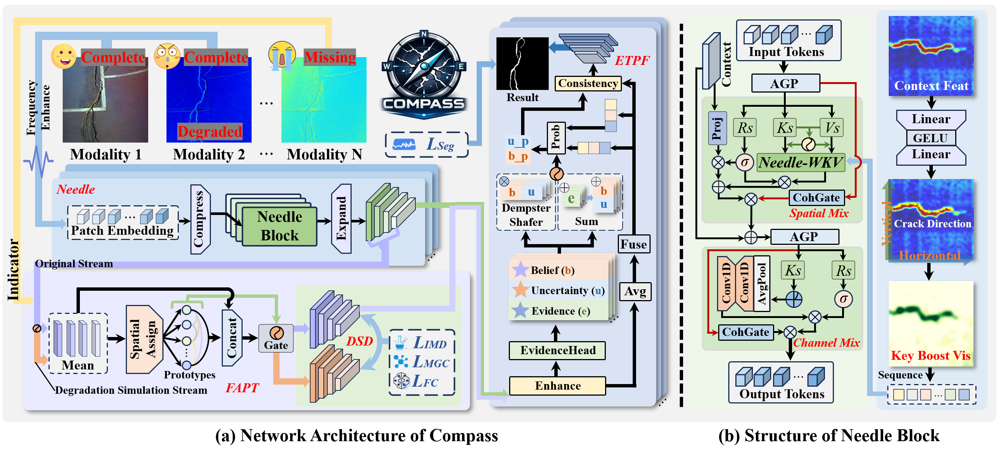

<div align="center">
  <h1>Compass</h1>
</div>
<p align="center">
    
</p>

<div align="center">
<h2>Compass: Degradation-Simulated Reciprocal Learning with Lightweight Needle RWKV for Multimodal Crack Segmentation under Missing Modalities</h2>
</div>
## 📬 News
- **2026-11-07**: The implementation code of our Compass is now available in this repository. Enjoy!🥰🥰🥰

- **2026-07-10**: 🎉🎉🎉We are delighted to announce that our **Compass** has been accepted by the **ACM MM 2026**! The paper and the code will be available soon.

  

## 🛠️ Method Overview

<p align="center">
    
</p>
In multimodal crack segmentation for industrial facilities, the key challenge is preventing missing modalities from degrading pixel-level performance while maintaining low computational cost. Existing methods struggle to address semantic degradation caused by missing modalities. We propose Compass, a lightweight network for robust crack segmentation under arbitrary missing modalities. Compass comprises Degradation Simulation Distillation (DSD), Needle Block, and Evidential Topology-Preserving Fusion (ETPF). DSD constructs a degradation simulation stream that mimics more severe missing conditions and performs reciprocal distillation with the original stream, decoupling complete perception from degradation adaptation. Within DSD, Feature-Aware Prototype Transmitter (FAPT) performs modality-agnostic prototype-guided feature completion to maintain semantic integrity under incomplete modality conditions. As the lightweight backbone, Needle incorporates crack directional cues into the WKV key modulation through Geometry Conditioned Modulation, and integrates connectivity-aware gating with anisotropic context probing for structure-aware modeling. ETPF fuses multimodal features via Dempster-Shafer evidential combination with uncertainty-gated decoding, preserving crack topology while suppressing unreliable features. Experiments on three datasets demonstrate state-of-the-art (SOTA) performance under diverse missing modality scenarios. Even with 90% depth modality missing on CrackDepth, Compass achieves F1 of 0.8216 and mIoU of 0.8434 with only 2.58M parameters.


## 🚀 Getting Started

### ⚙️ Environment Setup

Create and activate the `Compass` environment using the following commands:

```shell
conda create -n Compass python=3.11 -y
conda activate Compass
pip install torch==2.9.1 torchvision==0.24.1 torchaudio==2.9.1
pip install -U openmim
mim install mmcv-full mmengine
pip install numpy==1.24.0 thop timm tqdm opencv-python
```


### 📊 Complexity Analysis

Execute the following command to calculate the model parameters (Params) and FLOPs:

```
python eval_compute.py
```

### 🏋️ Training

Configure the dataset paths and hyperparameters in `main.py`, then start the training process:

```
python main.py
```

### 🎯 Inference

After training, update the checkpoint path in `test.py` and run the following command for inference:

```
python test.py
```

### 📈 Evaluation

To calculate performance metrics, update the result path and execute the following:

```cd eval
cd eval
python evaluate.py
```


## 🏷️ License

This project is released under the [**Apache 2.0**](https://www.apache.org/licenses/) license.


## 📟 Contact

If you have any other questions, feel free to contact me at **liuhui1109@stud.tjut.edu.cn**.
